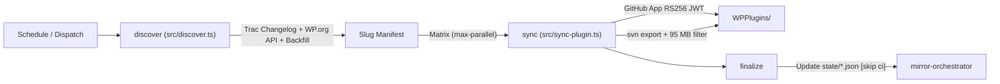

# WPPlugins Mirror Orchestrator

Serverless, zero-dependency **WordPress.org SVN-to-GitHub** plugin mirror
orchestrator targeting the [WPPlugins](https://github.com/WPPlugins)
organization. Built with **Deno (TypeScript, strict mode)** and running entirely
on **GitHub Actions**.

## Architecture

All discovery, SVN exporting, and Git pushing happen centrally in this
repository—individual `WPPlugins/<slug>` repositories remain clean mirrors with
no workflow files or per-repo secrets.

## Features

- **Zero-dependency GitHub App Auth** ([src/github-app.ts](src/github-app.ts)):
  Mints installation access tokens via WebCrypto (`crypto.subtle` `RS256` JWT
  signing, supporting both PKCS#1 and PKCS#8 PEMs) with rate-limit backoff.
- **Resilient Multi-Source Discovery** ([src/discover.ts](src/discover.ts)):
  Polls the WordPress.org Trac revision stream, falls back cleanly to the WP.org
  Plugin Directory API (`updated` + `new`) if Trac is unavailable, and mixes in
  bounded slices of `state/backfill-queue.json`.
- **Safe Incremental SVN Sync** ([src/sync-plugin.ts](src/sync-plugin.ts)):
  - Creates missing `WPPlugins/<slug>` repos with description, WordPress.org
    homepage, and `wordpress-plugin` topic.
  - Exports missing version tags in semver order as annotated Git tags and syncs
    `trunk/` onto `main`.
  - Strips individual files larger than `95 MB` (logged to
    `state/oversized.json`) to avoid GitHub's `100 MB` blob limit.
- **Read-Only Dry Runs**: Every CLI script supports `--dry-run` with zero
  `state/` or GitHub write mutations.

## CLI Reference

| Command                                                               | Purpose                                             |
| :-------------------------------------------------------------------- | :-------------------------------------------------- |
| `deno task discover [--dry-run] [--max-slugs N] [--backfill-limit N]` | Discover plugins to sync and emit JSON manifest     |
| `deno task sync --slug <slug> [--max-tags N] [--dry-run]`             | Sync a single plugin's SVN tags & `trunk` to GitHub |
| `deno task backfill [--pages N] [--dry-run]`                          | Seed or advance `state/backfill-queue.json`         |
| `deno task check`                                                     | Type-check all TypeScript sources (`strict: true`)  |
| `deno task test`                                                      | Run unit tests in `tests/`                          |

## State Files

| File                                                   | Purpose                                                      |
| :----------------------------------------------------- | :----------------------------------------------------------- |
| [state/cursor.json](state/cursor.json)                 | Tracks `last_global_rev`, `backfill_page`, and `last_run_at` |
| [state/backfill-queue.json](state/backfill-queue.json) | Paginated queue of plugins to catch up in safe batches       |
| [state/oversized.json](state/oversized.json)           | Audit log of files `> 95 MB` skipped during sync             |
| [state/errors.json](state/errors.json)                 | Last recorded error per failing slug                         |

## Documentation

- [Setup Guide](SETUP.md) — Creating the GitHub App, installing it on
  `WPPlugins`, and configuring secrets.
- [Contributing](CONTRIBUTING.md) — Local development and PR guidelines.
- [Security Policy](SECURITY.md) — Reporting vulnerabilities.
